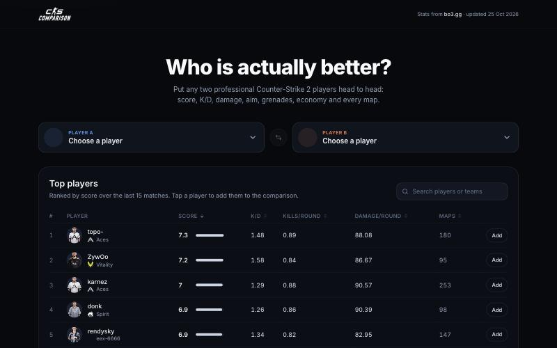
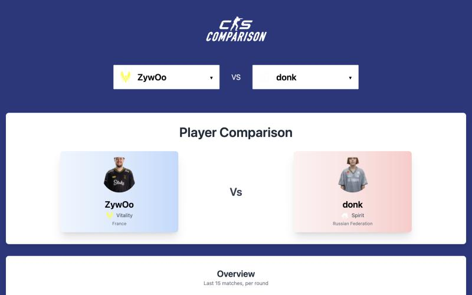
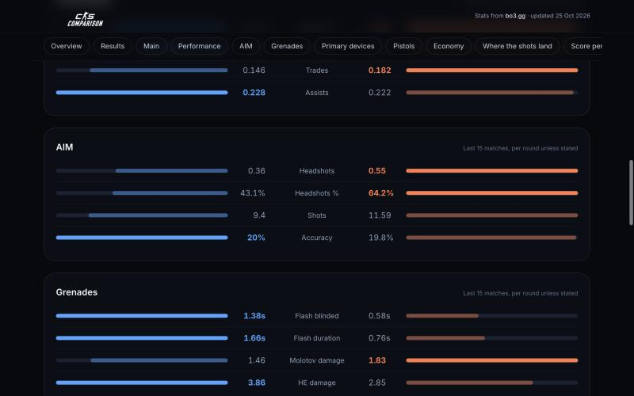
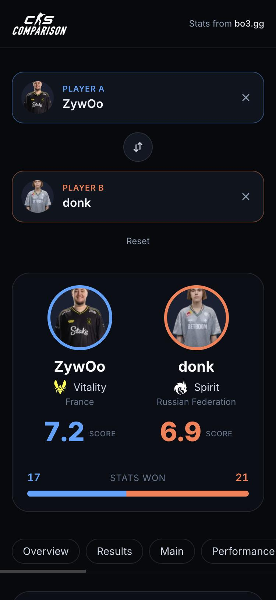

<p align="center">
  
</p>

<h1 align="center">CSComparison</h1>

<p align="center">
  <em>Who is actually better?</em><br />
  Compare any two professional Counter-Strike 2 players side by side: score, K/D, damage, aim,
  grenades, economy, accuracy by body part and score per map, with the better value highlighted.
</p>

<p align="center">
  
  
  
  
  
</p>

<p align="center">
  <a href="https://cscomparison.vercel.app">Live site</a> ·
  <a href="https://github.com/KDominikk00/HLTVScraper">Scraper and API repo</a>
</p>

<p align="center">
  
  
  
  
</p>

## Features

- **Head to head.** Pick two players and see them face to face with their scores, and a tally of how many stats each one wins.
- **Mirrored stat bars.** Every stat is a pair of bars growing from the centre, player A in blue and player B in orange. The winner's side is bright, the other side dimmed. Stats where lower is better (deaths, opening deaths) are handled, and stats with no clear direction, such as kill cost, are not scored.
- **Every stat category.** Overview, results over the last 6 months, then Main, Performance, AIM, Grenades, Primary devices, Pistols and Economy, plus accuracy by body part and score per map, with a sticky row of links to jump between them.
- **Shareable links.** The two players live in the address bar (`/?a=zywoo&b=donk`), so any comparison can be sent as a link.
- **Sortable leaderboard.** Search by player or team, sort by score, K/D, kills or damage per round, and add a player to the comparison with one click. 50 rows at a time.
- **Keyboard friendly pickers.** Searchable dropdowns with arrow keys, enter and escape, a swap button and a reset.
- **Loading and error states.** Skeletons while stats load, a note when the free server is waking up, and a retry button if the API cannot be reached.
- **Responsive and accessible.** Works from phone to desktop, with labelled controls, sort state announced to screen readers and reduced-motion support.
- **No accounts.** Nothing is stored about visitors.

## How it works

```
 bo3.gg --(weekly scrape, headless Chrome)--> GitHub release "data" --> CS Stats API (Render)
                                                                                |
                                                          GET /api/v1/players   |   GET /api/v1/players/{slug}
                                                          (once, on page load)  |   (for each selected player)
                                                                                v
                                                                   CSComparison (React, Vercel)
```

The page loads the list of player summaries once and keeps it in a React context. That list feeds the leaderboard and the two pickers. When two players are selected, the full stats of each are fetched from the API and compared in the browser. The numbers come from [bo3.gg](https://bo3.gg), scraped by the [CS Stats API](https://github.com/KDominikk00/HLTVScraper), so the site shows bo3.gg's own `score` rating and not HLTV rating.

## Tech stack

| Area | Choice |
| --- | --- |
| UI | React 19, function components and hooks |
| Build | Vite 8 with `@vitejs/plugin-react` |
| Styling | Tailwind CSS 4 via its Vite plugin, theme tokens in `src/index.css`, Inter as the font |
| Data | Plain `fetch` with `AbortController`, a context for the player list, a `usePlayer` hook for single players, the selection kept in the URL |
| Quality | ESLint 9 (flat config, React and React Hooks rules), Vitest for the comparison logic |
| Hosting | Vercel, deployed from `main` on every push |

## Getting started

Requirements: Node.js 20+ and a running copy of the [CS Stats API](https://github.com/KDominikk00/HLTVScraper).

```bash
# 1. start the API (in the other repo), a small run is enough
SCRAPER_MAX_PLAYERS=10 SCRAPER_MIN_PLAYERS=5 ./mvnw spring-boot:run

# 2. start the site
cp .env.example .env
npm install
npm run dev              # http://localhost:5173
```

The live API only accepts requests from the deployed site, so local development needs a local API.

| Script | |
| --- | --- |
| `npm run dev` | Dev server with hot reload |
| `npm run build` | Production build in `dist` |
| `npm run preview` | Serve the production build locally |
| `npm run lint` | ESLint |
| `npm test` | Vitest, covers the comparison logic |

## Configuration

| Variable | Default | |
| --- | --- | --- |
| `VITE_API_BASE_URL` | `http://localhost:8080` | Base URL of the API, without a trailing slash. Read at build time, so it must be set in Vercel's environment settings before a build. |

## Project structure

```
src/
  main.jsx, App.jsx        entry point and page shell
  index.css                Tailwind theme: colours for the two sides, font, background
  api/players.js           fetchPlayers, fetchPlayer (base URL from VITE_API_BASE_URL)
  context/                 PlayerProvider, the player list shared by the whole page
  hooks/
    usePlayer.js           loads one player's full stats
    useSelection.js        the two selected players, synced with the URL
  lib/
    compare.js             builds every comparison section, decides winners, tallies the score
    compare.test.js        unit tests for the above
    format.js, tones.js    number and date formatting, colours of side A and B
  components/
    Main.jsx               pickers, then leaderboard or comparison
    Pickers.jsx, PlayerPicker.jsx    the two dropdowns and the swap and reset controls
    Leaderboard.jsx        searchable, sortable ranking
    Compare.jsx            loads both players and lays out the comparison
    HeadToHead.jsx, SectionNav.jsx, StatSection.jsx    hero, section links, mirrored bars
    LoadState.jsx, Skeleton.jsx    loading and error states
    Header.jsx, Footer.jsx, Avatar.jsx, TeamLogo.jsx, icons.jsx
docs/screenshots/          images used in this README
```

## Deployment

The site runs on Vercel. Import the repository, keep the detected Vite preset and set `VITE_API_BASE_URL` to the API's URL, for example `https://cs-stats-api.onrender.com`. Every push to `main` deploys to production. The API must then list the site's address in its `SCRAPER_ALLOWED_ORIGINS`, otherwise the browser blocks the requests.

## Limitations

- **Slow first visit.** The API runs on a free plan that sleeps when idle, so the first request after a quiet spell can take about a minute. The page shows "Loading players..." until it answers.
- **Weekly data.** The stats are refreshed once a week by a scrape that runs on the maintainer's computer. If it misses a week, the previous numbers stay up.
- **Partial player pool.** Only players from the ranked list and current tournaments are included, around 250 in total. Players without a photo get a plain circle.
- **Windows differ.** Results, accuracy and map stats cover the last 6 months, while the in-game categories cover the last 15 matches.
- **Few tests.** Only the comparison logic is unit tested. The components are checked by hand, plus linting and the production build.
- **Unofficial.** The site is a fan project, not affiliated with bo3.gg or Valve. Stats are informational.
